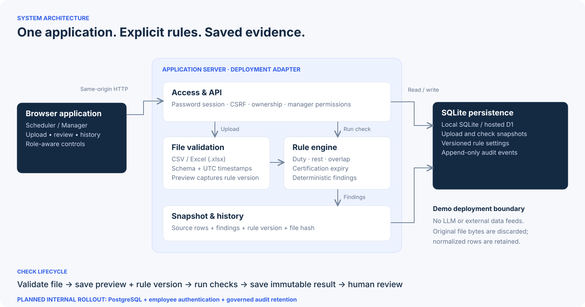

# System architecture

## Hosted web demo and planned internal rollout

The separate reference public review demo is deployed using a Cloudflare Worker and SQLite-based D1. It uses one shared team workspace, independent browser role sessions and an append-only audit event table. The following sections describe the retained **local FastAPI reference**, not the hosted implementation. Hosted implementation details are in `hosted/public/project-docs/architecture.md`. PostgreSQL and company authentication are planned for the internal server; see [transition plan](postgresql-plan.md).

## Local reference deployment shape

One FastAPI process serves a static browser UI, the API and documentation. SQLite is a local database file. No cloud services, external APIs, AI calls, workers or message queue are required. Modules shown inside the server boundary are **not microservices**.

| Component | Implementation | Responsibility |
|---|---|---|
| Browser | `app/static/` | Login, upload, preview, findings, history, rule configuration |
| Request layer | `app/main.py` | Bounded request body, origin/host checks, session, CSRF and role enforcement |
| Parser | `app/parsing.py` | Strict CSV/XLSX schema, data validation, UTC normalization |
| Checker | `app/engine.py` | Deterministic findings with evidence; no side effects |
| Persistence | `app/storage.py` | SQLite schema, connections, demo account setup, password hashes |

## Upload-to-result lifecycle

1. Browser sends a multipart upload with its session cookie and CSRF header.
2. API checks authentication and request size. Parser validates the entire file. Any invalid row rejects the whole upload; errors return source row numbers.
3. The server stores normalized rows, sanitized filename, source SHA-256, upload time, owner and the current rule version in one transaction. Original file bytes are not retained after parsing.
4. The preview shows up to 20 records and the captured rule version. All accepted duties are checked.
5. On explicit **Run roster check**, the server loads those rows and that captured rule version, runs the pure engine and stores the result atomically. Repeated check requests for one upload return the same result ID.
6. Later reads use the persisted result and the referenced immutable rules. New rule versions apply only to new upload previews. An existing preview retains its shown version even if rules change before Run.

`BEGIN IMMEDIATE` serializes rule-version selection, configuration changes and check creation. A unique constraint on `runs.upload_id` prevents duplicate results for one preview. A failed parse creates no upload or run. A failed check transaction cannot leave a partial run.

## Data model

| Table | Main fields | Relationship / purpose |
|---|---|---|
| `users` | id, name, email, role, password_hash | Seeded role identities |
| `sessions` | token_hash, user_id, csrf, expires | Eight-hour server-side sessions |
| `login_attempts` | address, count, window_start | Local IP-based login throttling |
| `rule_versions` | id, rules_json, created_by, created_at, reason | Append-only configuration versions |
| `uploads` | id, owner_id, filename, file_hash, created_at, rule_version, rows_json | Validated preview and its rule reference |
| `runs` | id, upload_id, created_at, result_json | Immutable result snapshot, rows, flags, coverage, engine version |

Foreign keys are enabled per connection. WAL mode and a 15-second SQLite timeout support modest local concurrency. JSON payloads keep the small snapshot model simple; this is not an analytics warehouse. The schema version is currently 1 (`PRAGMA user_version`). There is no migration framework yet.

## API map

| Method | Endpoint | Permission / behavior |
|---|---|---|
| GET | `/api/health` | Public health status |
| POST | `/api/auth/login` | Password authentication, set session cookie |
| GET | `/api/auth/me` | Current identity and CSRF token |
| POST | `/api/auth/logout` | Invalidate session and clear cookie |
| GET | `/api/rules` | Any signed-in user, active configuration |
| GET | `/api/rules/history` | Manager, up to 100 configuration versions |
| POST | `/api/rules` | Manager, reason and expected version required |
| POST | `/api/uploads` | Any signed-in user, validates and creates preview |
| POST | `/api/uploads/{id}/check` | Owner or manager, idempotent per upload |
| GET | `/api/runs` | Owner-only scheduler list or manager all-team list |
| GET | `/api/runs/{id}` | Owner or manager, full evidence and original rules |
| GET | `/api/templates/{csv,xlsx}` | Any signed-in user, synthetic sample download |

History filters: `q` (filename substring), `from_date` and `to_date` (inclusive UTC YYYY-MM-DD), `offset` (25 checks per page). Filenames use parameterized SQL LIKE matching; `%` and `_` have SQL wildcard meaning. The machine-readable OpenAPI schema is available at `/openapi.json`. Interactive CDN-based API documentation is disabled to keep the app fully local.

## Authentication and authorization

Passwords are stored as salted PBKDF2-HMAC-SHA256 hashes with 600,000 iterations. Session tokens have 32 random bytes and only their SHA-256 hashes are stored. Cookies are HttpOnly, SameSite=Strict and expire after eight hours. Logout invalidates the token. Secure cookies are opt-in with `CREWCHECK_SECURE_COOKIE=1` for HTTPS deployments.

Mutating authenticated API calls require a session-linked `X-CSRF-Token`. Origin checks reject other origins. Host validation allows localhost, 127.0.0.1 and testserver. Manager checks and ownership restrictions run on the server; hiding a navigation item is not the access control. Role values cannot be supplied by the client at login. Ten failed attempts per IP in five minutes trigger a throttle. This is a minimal local control, not a production identity solution.

All UI data derived from files is HTML-escaped. No uploaded text executes as code. Browser CSP allows local scripts and assets only. SQL parameters are bound. File types, parsed sizes and expanded XLSX size are restricted. Raw uploads are not executed or copied to a public static path.

## Production boundary

This is a single-organization local demo. Production work includes approved regulation profiles, identity/SSO integration, user provisioning, TLS, host configuration, backup/restore, retention and deletion, stronger rate limits, access audit events, monitoring, load testing and a scalable database strategy if required. No claim is made about supported concurrent user count.
