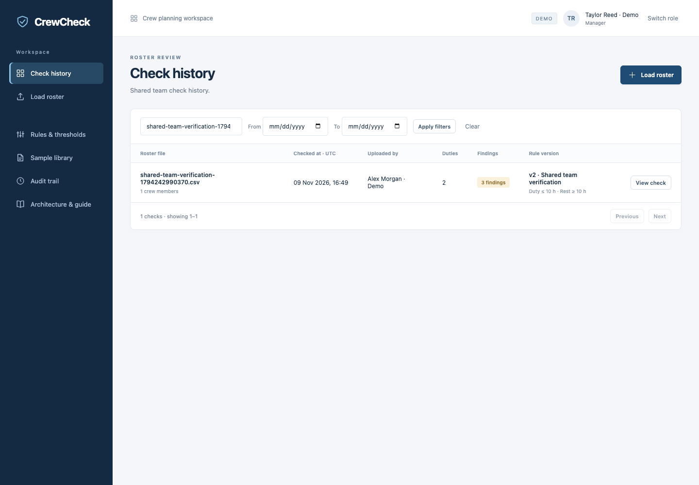
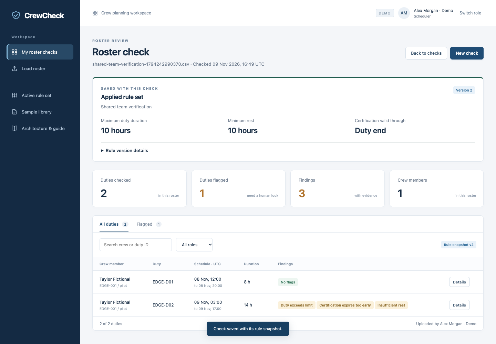

# Shared workspace verification

Verified 9 November 2026 against the production Worker build with persistent local D1 storage. Chrome ran in separate browser contexts with independent cookie jars at 1440 × 1000. No API mocks were used.

## Automated checks

- Hosted tests: **17 passed** (`node --test tests/*.test.mjs`).
- TypeScript: `tsc --noEmit` passed.
- Production build passed.
- New additive migration applied successfully to a local D1 database containing prior workspace records. Unit tests also confirm legacy records remain unchanged and inaccessible from shared sessions.
- Regression coverage includes shared history, per-session CSRF/logout, expired sessions, concurrent first visits, conflicting policy edits, immutable saved rules and idempotent checks.

## Browser results

1. Scheduler uploaded `01_multiple_violations.csv` through the file input, renamed to `shared-team-verification-1794242990370.csv`; the saved result contained three findings.
2. Manager in a separate browser context refreshed history, filtered by that filename and opened the same check (`920a6a820f384a7196f27153`). Both contexts returned identical saved result objects, including the rule snapshot.
3. Manager created v3. Scheduler’s next file preview and result captured v3; the earlier check retained v2 unchanged. This local database had an earlier rehearsal policy, so this was deliberately tested without relying on a pristine v1 database.
4. Scheduler logged out. Manager remained signed in and could read the audit event. A third, fresh browser session could reopen the original scheduler check.
5. No browser runtime errors occurred.

These screenshots record local D1 verification, not a production-data migration. Legacy browser-private data is retained separately; it is not automatically exposed in the shared team. See [rollout behavior](shared-workspace.md).
