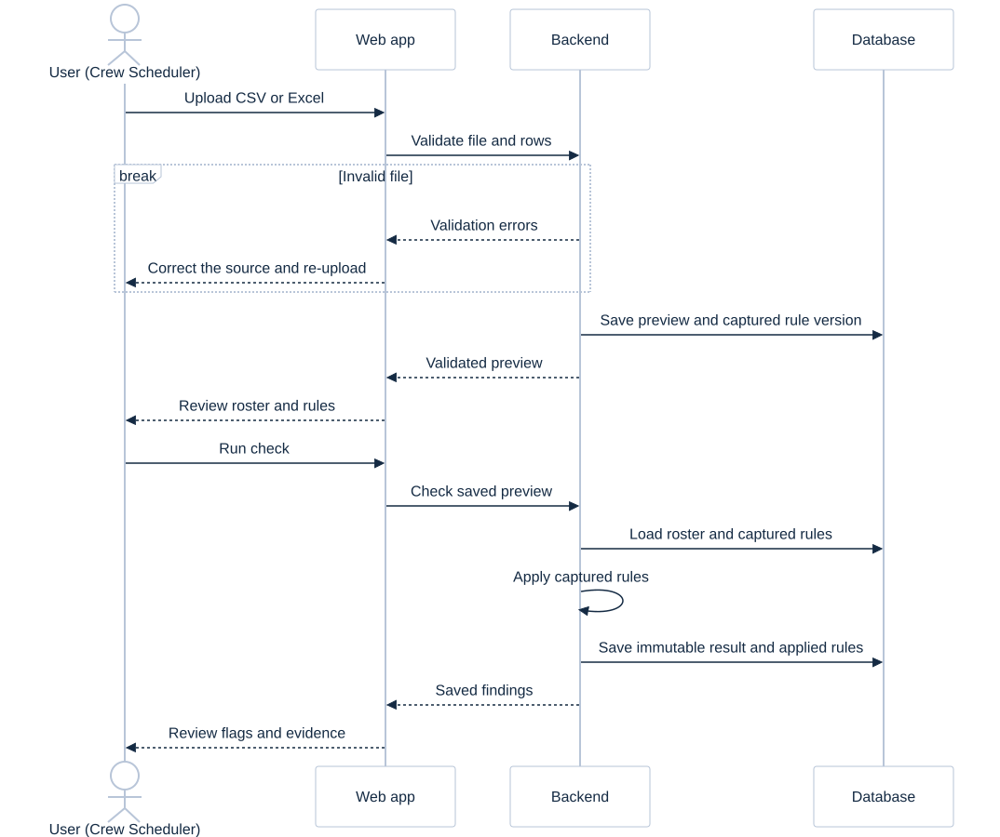

# User workflow sequence

This page and its sequence diagram describe the **local account-based reference**. The public web demo starts a Scheduler directly at upload after role selection; its Manager sees shared team records from any browser or computer. Demo ownership is by the shared scheduler/manager role, not employee identity. The current meeting walkthrough is in sections 4–8 of the [project handbook](handbook/crewcheck-project-handbook.pdf).

## Confirmed MVP permissions

| Action | Scheduler | Planning manager |
|---|---|---|
| Sign in / sign out | Yes | Yes |
| Upload CSV/XLSX and preview | Yes | Yes |
| Run a check | Own uploads | Any accessible upload |
| Open own results and history | Yes | Yes |
| Read another user's historical results | No | Yes |
| Read active thresholds | Yes | Yes |
| Change thresholds / read version history | No | Yes |
| Change a crew schedule | No | No |

Schedulers can upload rosters and review their own results. Planning managers can review team history and configure thresholds. The expected number of users remains to be confirmed.

## Scheduler journey

1. Sign in. **My roster checks** displays only the scheduler's completed checks.
2. Choose **Load roster**. Download a CSV/Excel sample or select a file. A sample button uses the same upload API as a local file.
3. If invalid, read row-specific errors, correct the source and retry. The whole file must validate.
4. Review filename, crew/duty counts, UTC timestamps, first 20 rows and captured rule version.
5. Choose **Run roster check**. The result is saved, then displayed.
6. Filter to flagged duties, search by crew/duty and filter by crew role. Open **Details** to inspect observed value, expected value, rule code and source timestamps.
7. Decide next steps outside the tool. The application never edits the roster or sends notifications.
8. Revisit a saved result from **My roster checks**.

## Manager journey

1. Sign in. **Check history** displays completed checks from all users.
2. Search by filename or UTC check date range and open a historical result.
3. Inspect its original findings, uploader, source digest, engine version and rule snapshot.
4. Open **Rules & thresholds**. Adjust demo values or the certification assessment point.
5. Enter a reason and save a new version. Concurrent stale updates return a conflict, requiring a reload.
6. Future upload previews capture that version. Existing previews and completed runs remain on the version they already captured.
7. Managers can use the same upload-and-check flow as schedulers.

## Failure / incomplete-data behavior

- Unauthorized user: sign-in required; another scheduler's record returns 404.
- Missing CSRF token or manager permission: request rejected.
- Unsupported file / invalid row: row errors, no partial check.
- No preceding duty in the file: rest coverage explicitly marked incomplete for the first duty of each crew member.
- Missing certification expiry: check runs and creates an incomplete-evidence finding.
- Missing or malformed timestamp / missing required identity: upload rejected.
- Unexpected server failure: retry message; no fabricated or cached-success result.
- No results / no matching filters: explicit empty state.
