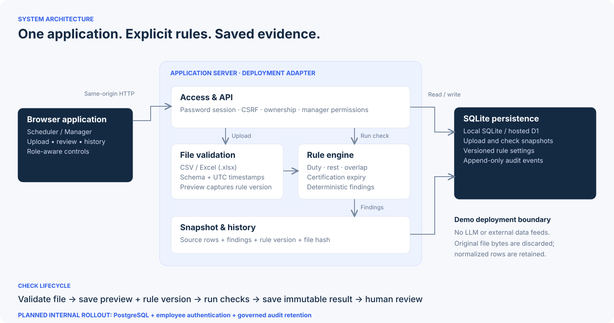

# Web demo architecture

The public demo serves the same roster review workflow through a Cloudflare Worker (Vinext) and a persistent Cloudflare D1 database based on SQLite. A local FastAPI/Python + SQLite reference also remains in the project. These are two deployment implementations, not microservices that call each other. Both deterministic checkers are tested against the same synthetic fixtures.

## Request path

Browser → same-origin API → browser session and role checks for the shared team → bounded CSV/XLSX parsing → normalized UTC rows → explicit deterministic checks → immutable result and audit event → browser evidence view.

No LLM or airline integration is used. Original file bytes are discarded after parsing; normalized rows and source SHA-256 are retained. Each upload captures a rule version. That version remains fixed even if a manager edits thresholds before Run. Repeating Run for one upload returns the existing result.

## Persistent data

- `demo_workspaces`: the shared team and active rule version; legacy private workspace rows remain preserved.
- `demo_sessions`: hashed browser token, selected role, CSRF token and seven-day expiry, separate from shared data.
- `demo_rule_versions`: immutable settings, version, change reason and demo actor.
- `demo_uploads`: normalized rows, owner role, source hash and captured rules.
- `demo_runs`: immutable result snapshot and source upload, unique per upload.
- `demo_audit_events`: actor, action, timestamp, target and details.

Database mutations and their corresponding audit event use a transaction/batch. Rule updates use an optimistic expected-version condition. Historical results are never recalculated by a later configuration change. Every read is scoped to the shared team; schedulers additionally see only scheduler-owned uploads/runs. Managers can inspect all team records across browsers and computers.

## Demo access boundary

Anyone with the link can select a demo role in **one shared team workspace**. This does not authenticate a real employee. An HttpOnly, Secure-on-HTTPS, SameSite cookie identifies only the browser session. Its hash, role and CSRF token are stored in `demo_sessions`. Mutation APIs verify the session, role, CSRF token and request origin. Logging out or changing roles affects only that session. Different browsers and computers see the same shared records, subject to scheduler/manager permissions.

Browser sessions last seven days; shared records do not expire with a session. Automatic record erasure is not implemented. There is no fixed duty-row limit. Upload and storage budgets are deployment settings; the old per-workspace lifetime upload/version quotas no longer apply. Use fictional data only. These are demo limits, not supported production capacity claims.

## API

`POST /api/auth/login` selects a demo role; `GET /api/auth/me` reads it; `POST /api/auth/logout` leaves it. `POST /api/uploads` validates a file and creates a preview; `POST /api/uploads/{id}/check` creates/reuses a result. `GET /api/runs` and `GET /api/runs/{id}` read authorized results. `GET /api/rules`, `GET /api/rules/history`, `POST /api/rules` read/publish policy versions. `GET /api/audit` is manager-only. `GET /api/health` is public. `/samples/` serves fictional CSV/XLSX downloads.

## Next deployment

For the internal server, PostgreSQL and company authentication are planned. Migration preserves record IDs, rule references and historical snapshots; database access changes without changing the deterministic rules. This work is not yet implemented. See [PostgreSQL transition plan](postgresql-plan.md).
