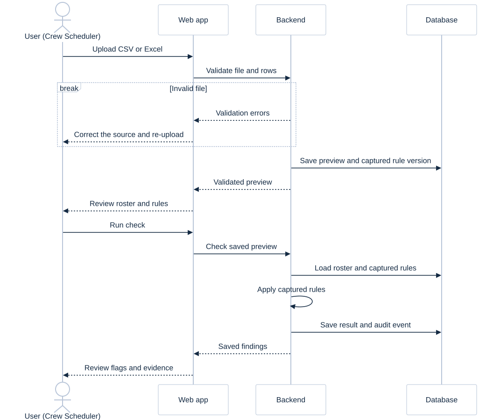

# User workflow sequence

## Entry

Choose a demo role without account registration. A first visit creates a private-to-this-browser sandbox with two fictional saved checks. Returning with the same cookie reopens it until access expires. Switching roles keeps that sandbox.

## Scheduler

Entry opens Load a roster so the full demonstration begins with an actual file upload. Download a starter CSV/XLSX, use Browse files, review the preview, and Run roster check.

Open own saved checks, upload CSV/XLSX, correct reported input errors, preview rows and the captured rule version, run the deterministic checks, filter results and inspect evidence. Active thresholds can be read but not edited.

## Manager

All scheduler actions plus all history in the same visitor sandbox, rule-version history, threshold changes with a reason, and audit events. Other visitors' workspaces are never visible.

## Human follow-up

The app flags evidence. It does not change schedules, remove crew, contact employees or make staffing decisions. Human review and correction happen outside this MVP.

## Production difference

Demo role selection is not employee authentication. Internal deployment is planned to use company sign-in, assigned roles, PostgreSQL storage and an agreed audit retention policy.
